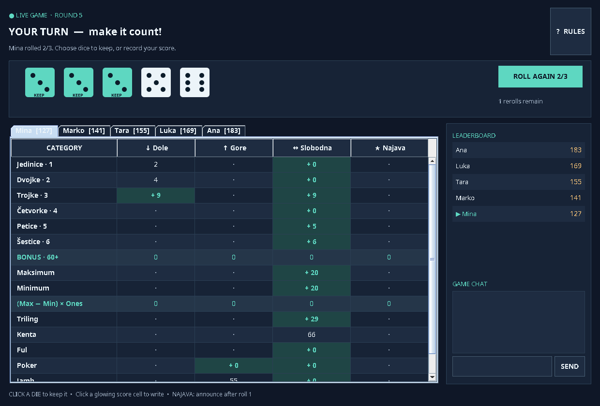

# 🎲 JAMB — Java Multiplayer (2–5 Players)



A complete Java Swing desktop game with a TCP server: **five friends**, shared live scorecards, private dice turns, announcements, chat, leaderboard, winners, and rematches.

- **Java 17+**, **no Maven/Gradle or external dependencies**.
- **5 dice**, up to **3 rolls per turn**. Click a die to keep it.
- **52 scoring cells per player** across four columns: **Dole ↓, Gore ↑, Slobodna ↔, Najava ★**.
- **Kenta (66/56/46)**, **Triling (+20)**, **Ful (+30)**, **Poker (+40)**, **Jamb (+50)**; Max/Min bonus, number bonus and live totals.
- **2–5 humans**, same room, turn-by-turn, over a private network.
- The **server is authoritative**: dice rolls, legal columns, scores, turn order, and completion are verified server-side.
- **Reconnect** under the same name on the same PC (per-device saved token), and **host skip** for an offline player.
- Host **PLAY AGAIN** after a completed game; all players must be reconnected.

## Start playing (Windows — easiest)

1. Install **[Java 17 or newer](https://adoptium.net/temurin/releases/)** on every computer. The *JRE* is enough to run the prebuilt JAR; the *JDK* is required only to compile from source.
2. Download this project or download `Jamb-Multiplayer.jar` from your GitHub Actions artifact.
3. Double-click **`Play-Jamb.bat`** (if the entire project is present), or run `java -jar Jamb-Multiplayer.jar` (if only the JAR was downloaded).
4. Host: enter your name and click **HOST & PLAY ON THIS PC**.
5. Friends: enter their *own unique* names and the **host's Tailscale IP** (see below), leave TCP port `5050`, and click **JOIN FRIEND'S GAME**.
6. After all five are in the lobby, the host presses **START GAME**.

The same single JAR runs both the GUI and server. A complete five-player match takes **260 scored turns** (52 per player).

## Playing with friends over the internet (recommended)

**GitHub hosts the source and downloadable JAR; it does not host a running Java Swing game server.** The host's computer (or another online computer) runs the game server. Java Swing is a desktop window, **not** a website that opens in GitHub Pages.

Recommended: use **[Tailscale](https://tailscale.com/)** to create a trusted private network.

1. All players install Tailscale and join the same Tailnet, or receive a device-share invitation from the host.
2. The host launches the GUI, chooses **Host & Play**, and copies the machine's Tailscale IPv4 address, normally `100.x.y.z`.
3. Each friend launches the GUI and uses that IPv4 address plus port `5050`.
4. If Windows asks, allow Java through the firewall for the appropriate **private/trusted** network. The host should remain online for the whole match.

**Alternative:** the host may set up TCP port forwarding for port 5050 and connect through a public IP, but *this sample uses unencrypted TCP* and is designed for trusted/private networks, **not for exposure to the public internet**. A cloud VM or other always-on PC can host the server (preferably reachable privately via Tailscale):

```bash
java -jar Jamb-Multiplayer.jar --server 5050
```

Then all five players join via the GUI (in this setup the first connected player is the host, rather than the dedicated server itself).

## Controls

| Action | How |
| --- | --- |
| Roll | **ROLL DICE** button (up to three times per turn) |
| Keep die | Click a die after rolling (mint color = held) |
| Enter score | Click the highlighted box on **your** scorecard and confirm |
| Announce (Najava) | After your **first roll**, click an empty Najava cell to lock it; click it again when ready to score |
| View friends' boards | Click their scorecard tabs; all scoreboards are synchronized |
| Chat | Type and press Enter or **SEND** |
| Disconnect/reconnect | Open the same game on the same device with the same name and host address |
| Offline player's turn | Host can use **SKIP OFFLINE**, which writes 0 into the required available cell |
| Rematch | Host presses **PLAY AGAIN** after the match ends |

### Score rules used

These are a five-dice Serbian Jamb variant (other local versions sometimes use a sixth reserve die and additional columns):

- Ones–Sixes = sum of matching dice; when all six entries in a column are filled and total at least 60, **+30**.
- Max and Min = five-dice sum; the scoring contribution is **(Max − Min) × Ones**. These two cells themselves are *not* added a second time.
- Triling = three of the same face × face + 20; Kenta (either straight) = 66 / 56 / 46 by roll count.
- Ful = 3 of one face and 2 of another + 30; Poker = four of the same face × face + 40; Jamb = five of a kind × face + 50.
- If a chosen combination does not qualify, it scores **0**; writing any legal cell ends your turn.
- Dole fills top-to-bottom, Gore bottom-to-top, Slobodna any order; Najava locks one target *after* roll one and before roll two.

The program's built-in **? RULES** button describes this variant.

## Put the project on GitHub

Create an empty GitHub repository such as `jamb-java-multiplayer`, extract this package into it, and from a terminal in that folder run:

```bash
git init
git branch -M main
git add .
git commit -m "Initial Java Jamb multiplayer game"
git remote add origin https://github.com/YOUR-USERNAME/jamb-java-multiplayer.git
git push -u origin main
```

Open **GitHub → Actions → Build and test Jamb multiplayer → latest successful run → Artifacts → Jamb-Multiplayer-JAR**. Download, unzip the artifact, and share the JAR with your friends. Artifacts may require GitHub login and can expire; to distribute a permanent file, create a **GitHub Release** and attach `dist/Jamb-Multiplayer.jar`.

The GitHub workflow tests the scorer and a complete simulated **five-player, 260-move network game**, including reconnection, turn restrictions, and rematch.

## Build locally

```bash
# Windows
scripts\build.bat
# macOS / Linux
bash scripts/build.sh

# Client desktop GUI
java -jar dist/Jamb-Multiplayer.jar

# Dedicated server only
java -jar dist/Jamb-Multiplayer.jar --server 5050

# Linux/macOS tests (requires Python 3 for multiplayer integration checks)
bash scripts/test.sh
```

The source lives in `src/main/java/com/jamb/` and the tests in `src/test/java/com/jamb/` and `scripts/test_multiplayer.py`.

## Current boundaries

- One room per server process, **2–5 players**. No lobby passwords, TLS, user accounts, or matchmaking. Use a private network.
- The server keeps state **in memory**. Shutting down the server loses the ongoing match; reconnection works only while that server remains running.
- The first joined user acts as host. If that user disconnects but a dedicated server remains, host controls pass to the first still-connected user.
- A server must be restarted for a new set of players (after the previous match), unless the same players select **PLAY AGAIN**.
- Browser play is **not provided** by Java Swing. A GitHub Pages-only deployment requires a separate browser frontend and hosted backend.

## Attribution

Original Java implementation. Rules reference: [Jamb rules (jamb.com.hr)](https://jamb.com.hr/en/rules) and [Yamb Classic Serbian rules](https://www.iklub.rs/yc/pravilajamba.htm). Scoring uses the documented variant above where local variations differ.
